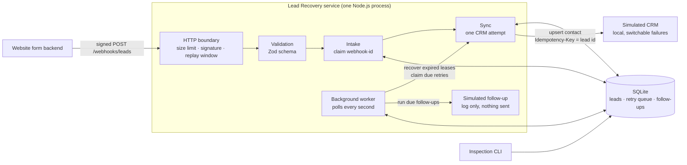
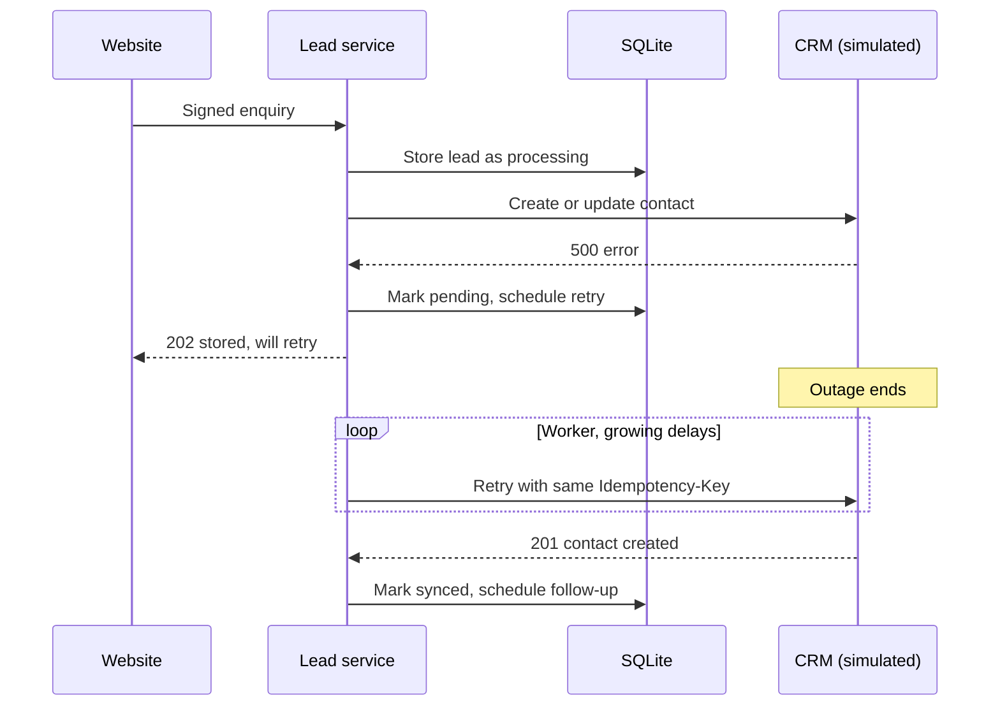
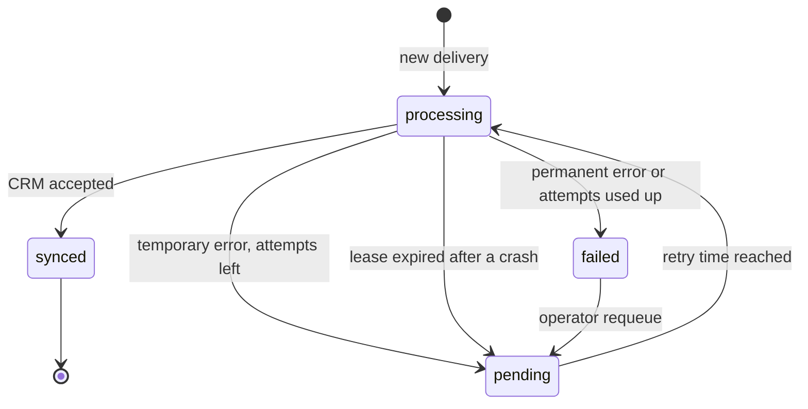

# Lead Recovery Automation

**A portfolio demonstration of a reliable website-enquiry → CRM integration.** It is built to keep enquiries safe when the CRM is down, slow or the server crashes, and to retry them automatically instead of letting them disappear.

> This is a demonstration project, not a deployed product. It runs entirely on a laptop, uses a **simulated CRM** and **synthetic data**, and never sends real emails, SMS or messages.

---

## In plain English

**The problem.** A small business's website sends each enquiry to its CRM. If the CRM is briefly unavailable, many simple integrations (e.g. a form → CRM webhook) fail silently. The enquiry never arrives, nobody follows up, and the business may lose the customer without knowing. A sender that retries can also create duplicate contacts.

**What this does.**

1. Accepts each enquiry only if it is genuinely from the website (signed request), and checks the data is valid.
2. **Saves it first**, then sends it to the CRM.
3. If the CRM fails, keeps retrying automatically with growing gaps, up to a set limit. Nobody has to resend anything.
4. Recognises repeated deliveries of the same enquiry, so it isn't processed twice.
5. Once the contact is in the CRM, schedules a follow-up task. Here it is simulated and only logged.
6. Lets an operator see what is pending, completed or failed, without showing personal details by default.

**What it is not.** It doesn't promise that no lead can ever be lost or duplicated. Its limits are listed honestly [below](#limitations).

---

## How it works



### Recovering from a CRM outage



### Lead lifecycle



### Key design decisions

| Decision | Why |
|---|---|
| Store the lead **before** calling the CRM | A CRM failure or a crash after this point leaves the enquiry stored and queued for retry |
| `UNIQUE(webhook_id)` in SQLite | A repeated or simultaneous delivery of the same event is recognised, including after a restart |
| Lead id sent as the CRM `Idempotency-Key`, CRM upserts by email | A retry after an uncertain result should update, not duplicate, the contact. This depends on the real CRM supporting it (see limitations) |
| Retries live in the database, not in memory | They survive restarts |
| Each attempt holds a **lease** with a token | A lead left `processing` by a crash is retried after the lease expires, and a worker that lost its lease can't overwrite a newer result |
| Temporary vs permanent errors | 408/429/5xx/timeouts are retried with exponential backoff, jitter and `Retry-After`; other 4xx fail at once and are never retried automatically |
| Signature on raw bytes, checked first | Modelled on [Standard Webhooks](https://www.standardwebhooks.com): HMAC-SHA256, constant-time compare, 5-minute timestamp window |
| Logs contain ids and statuses only | Sensitive keys (`email`, `phone`, `name`, `secret`, `authorization`…) are redacted at any depth |
| Built-in Node.js modules | Only one runtime dependency (`zod`). HTTP, SQLite, crypto and the test runner come with Node.js 24 |

---

## Try it in 2 minutes

Requires **Node.js 24+** (macOS: `brew install node`).

```bash
npm install
cp config/example.env .env
sed -i '' "s/^WEBHOOK_SECRET=.*/WEBHOOK_SECRET=$(openssl rand -hex 32)/" .env
npm run dev
```

In a second terminal:

```bash
# Take the simulated CRM down, then send an enquiry → 202 "pending"
curl -s -X POST localhost:4010/__control -d '{"mode":"fail-500"}'
npm run send-lead -- --id evt_demo_outage

npm run leads -- list            # status: pending, attempts climbing

# Bring the CRM back. Do NOT resend anything.
curl -s -X POST localhost:4010/__control -d '{"mode":"ok"}'
npm run leads -- list            # within seconds: synced, follow-up scheduled
```

For quicker retries during a demo, add to `.env`: `RETRY_BASE_DELAY_MS=1000`, `RETRY_MAX_DELAY_MS=4000`, `FOLLOW_UP_DELAY_MS=5000`, `LEASE_MS=8000`. A scripted walkthrough is in [docs/demo-script.md](docs/demo-script.md).

---

## Tested failure scenarios

`npm test` runs 46 automated tests against the real HTTP server, a real SQLite file and the simulated CRM. A controllable clock makes retry timing deterministic.

| Scenario | Expected behaviour (asserted by tests) |
|---|---|
| Valid enquiry | `201`, contact created, lead `synced`, one follow-up scheduled |
| Missing / forged signature | `401`, nothing stored, CRM not called |
| Old request replayed | `401 stale_timestamp` |
| Invalid data, bad JSON, wrong content type, > 64 KB | `422` with field errors / `400` / `415` / `413` |
| Same delivery repeated, 5 at once, or after a restart | Processed once; the others get `200 duplicate` |
| Same person enquires twice | One CRM contact (upsert by email) |
| CRM returns 500 during an outage | `202 pending`; retried automatically; synced after recovery **without redelivery** |
| Backoff schedule | Exact delays asserted (jitter fixed in tests) |
| CRM keeps failing | Stops after `RETRY_MAX_ATTEMPTS` CRM calls, ends `failed` |
| CRM returns 400 (permanent) | `failed` straight away, never retried automatically |
| CRM rate-limits (`429` + `Retry-After`) | Next attempt waits at least `Retry-After` |
| CRM hangs | Request times out; retried later |
| Process crashes mid-attempt | Lead recovered after its lease expires and then synced |
| Crash on the last allowed attempt | Ends `failed`, no further retries |
| A slow worker reports a result after its lease was taken over | Late result rejected |
| Two worker processes share one database | No lead sent to the CRM twice |
| Follow-up | One per synced lead, run once when due, none for unsynced leads |
| Phase 1 database | Migrated; unsynced leads queued for retry |
| CLI | Personal data hidden unless `--show-pii`; input validated |
| Logs | No names, emails, phone numbers or secrets |

Outage recovery and `kill -9` crash recovery were also checked by hand on the running app. CI (GitHub Actions, Node 24) runs typecheck, build and tests on every push and pull request.

---

## Running and inspecting

```bash
npm run dev                      # run from TypeScript source
npm run build && npm start       # or run the compiled build
```

This starts the webhook on `http://127.0.0.1:3000`, the simulated CRM on `http://127.0.0.1:4010` and the retry worker, all in one process. Leads are stored in `data/leads.db`. Ctrl+C shuts down gracefully.

**Demo sender** (signs requests like a real website backend):

```bash
npm run send-lead -- [--id <webhook-id>] [--email <email>] [--invalid] [--bad-signature] [--stale]
```

**Inspection CLI** (safe to run while the app is running):

```bash
npm run leads -- stats
npm run leads -- list [--status pending|processing|synced|failed] [--limit 20] [--show-pii]
npm run leads -- show <lead-id> [--show-pii]       # includes follow-up tasks
npm run leads -- requeue <lead-id>                  # failed → pending, attempts reset
```

**Simulated CRM controls** (`POST localhost:4010/__control`): `{"mode": "ok" | "fail-500" | "fail-429" | "fail-400" | "timeout"}` or `{"failNext": N}`. Its contacts are kept in memory (`GET /contacts` with `authorization: Bearer <CRM_API_KEY>`) and are cleared on restart; the SQLite lead store is what persists.

---

## API

`POST /webhooks/leads`

| Header | Value |
|---|---|
| `content-type` | `application/json` |
| `webhook-id` | Unique event id, reused on redelivery (`[A-Za-z0-9_.:-]{1,128}`) |
| `webhook-timestamp` | Unix seconds |
| `webhook-signature` | `v1,<base64 HMAC-SHA256(secret, "{id}.{timestamp}.{raw body}")>`; several space-separated values allowed for secret rotation |

```json
{
  "name": "Jane Doe",
  "email": "jane.doe@example.com",
  "phone": "+44 20 7946 0000",
  "message": "Interested in a quote for a kitchen refit.",
  "source": "website"
}
```

`name` and `email` are required; `phone`, `message` and `source` (default `website`) are optional. Unknown fields are rejected.

| Status | Body | Meaning |
|---|---|---|
| 201 | `created` | Lead stored and CRM contact created/updated |
| 200 | `duplicate` + `state` | This `webhook-id` was already received; nothing is redone |
| 202 | `pending` + `reason`, `nextAttemptAt` | Stored; CRM attempt failed; will be retried automatically |
| 202 | `failed` + `reason` | Stored; permanent CRM error; needs an operator |
| 400 | `invalid_json`, `invalid_webhook_id` | Malformed request |
| 401 | `missing_signature_headers`, `invalid_timestamp`, `stale_timestamp`, `invalid_signature` | Not authenticated; nothing stored |
| 413 / 415 / 422 | `payload_too_large` / `unsupported_media_type` / `validation_failed` + `details[]` | Rejected input |

Both `202` responses mean "stored, do not redeliver". `GET /health` returns `200 {"status":"ok"}`.

---

## Configuration

All variables are documented in [`config/example.env`](config/example.env) and validated at startup. Errors name the variable, never its value.

| Variable | Default | Purpose |
|---|---|---|
| `WEBHOOK_SECRET` | (required, ≥ 32 chars) | Shared signing secret |
| `CRM_TIMEOUT_MS` | 5000 | Per-request CRM timeout |
| `RETRY_MAX_ATTEMPTS` | 6 | Total CRM attempts per lead, including the first |
| `RETRY_BASE_DELAY_MS` / `RETRY_MAX_DELAY_MS` | 2000 / 300000 | Backoff start and cap (equal jitter) |
| `LEASE_MS` | 30000 | How long an attempt may run before it counts as abandoned; must exceed `CRM_TIMEOUT_MS` |
| `WORKER_POLL_MS` / `WORKER_BATCH_SIZE` | 1000 / 5 | Worker tick interval and leads per tick |
| `FOLLOW_UP_DELAY_MS` | 900000 | Time from CRM sync to the simulated follow-up |

---

## Verification

```bash
npm test          # 46 tests
npm run verify    # typecheck + clean build + tests + npm audit + git-ignore checks
```

---

## Limitations

- **Delivery to the CRM is at-least-once, not exactly-once.** If the process dies after the CRM accepted a request but before the result was saved, the retry sends it again with the same `Idempotency-Key`. That only avoids a duplicate if the real CRM honours idempotency keys or upserts by email. Many CRMs need a search-then-update step instead, so check each one's documentation.
- **Leads can still be lost before they are stored.** That includes a sender that never delivers, a request rejected as invalid, or a disk failure. Durability is that of one SQLite file on one machine.
- **The first CRM attempt runs inside the webhook request**, so a slow CRM delays the response by up to `CRM_TIMEOUT_MS`. For slow CRMs or impatient senders, store, answer `202` and let the worker make every CRM call.
- **Follow-ups are simulated.** They're marked completed and logged; nothing is sent. A real channel would need its own retries, opt-out handling and UK PECR/GDPR consent checks.
- **Single machine.** Several processes can share one SQLite file safely (tested), but several servers would need Postgres or similar.
- **No alerting.** Failed leads appear in logs and the CLI only.
- No data-retention job, no E.164 phone normalisation, and the simulated CRM's `/__control` endpoint is unauthenticated (it listens on `127.0.0.1` only).

---

## Project layout

```
src/
  main.ts                  wiring: app + worker + optional simulated CRM
  cli.ts                   inspection CLI
  config.ts                validated environment config
  logger.ts                JSON logger with redaction
  http/server.ts           HTTP boundary
  webhooks/signature.ts    signing and verification
  leads/schema.ts          lead schema
  leads/repository.ts      SQLite store, retry queue, follow-ups, migration
  leads/retry-policy.ts    backoff
  leads/sync.ts            one CRM attempt + state transition
  leads/intake.ts          webhook use case
  leads/worker.ts          retry / recovery / follow-up loop
  crm/client.ts            CRM HTTP client
  crm/mock-server.ts       simulated CRM
scripts/                   demo sender, verification
tests/                     automated tests
docs/                      case study, demo script
config/example.env         configuration template
.github/workflows/ci.yml   CI
```

## Data and safety

- Use synthetic data only. Examples use `example.com` addresses and an Ofcom drama-range phone number.
- Nothing leaves your machine: no emails, no SMS, no real CRM.
- `.env`, `data/` and local databases are git-ignored, and `npm run verify` checks this.
